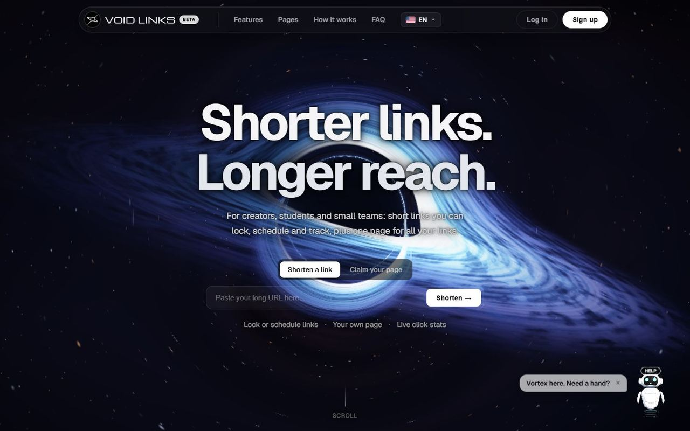
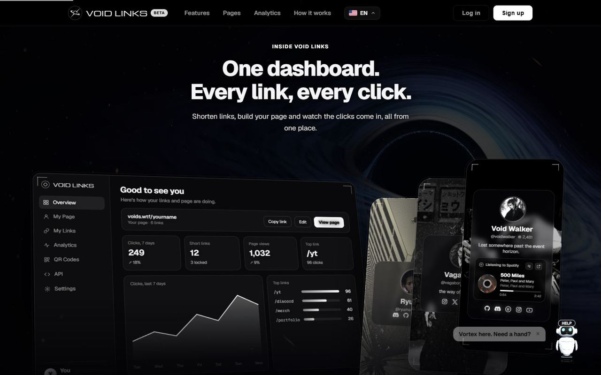
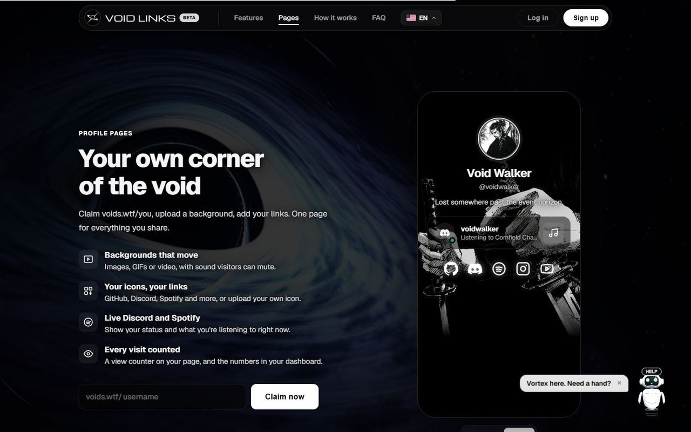
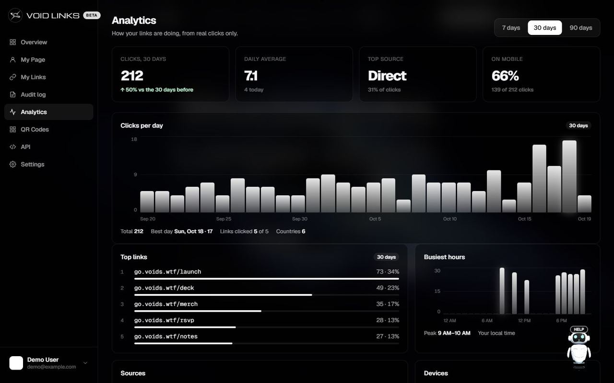
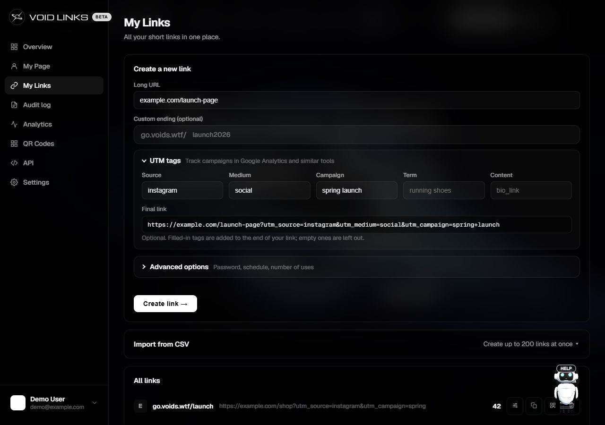
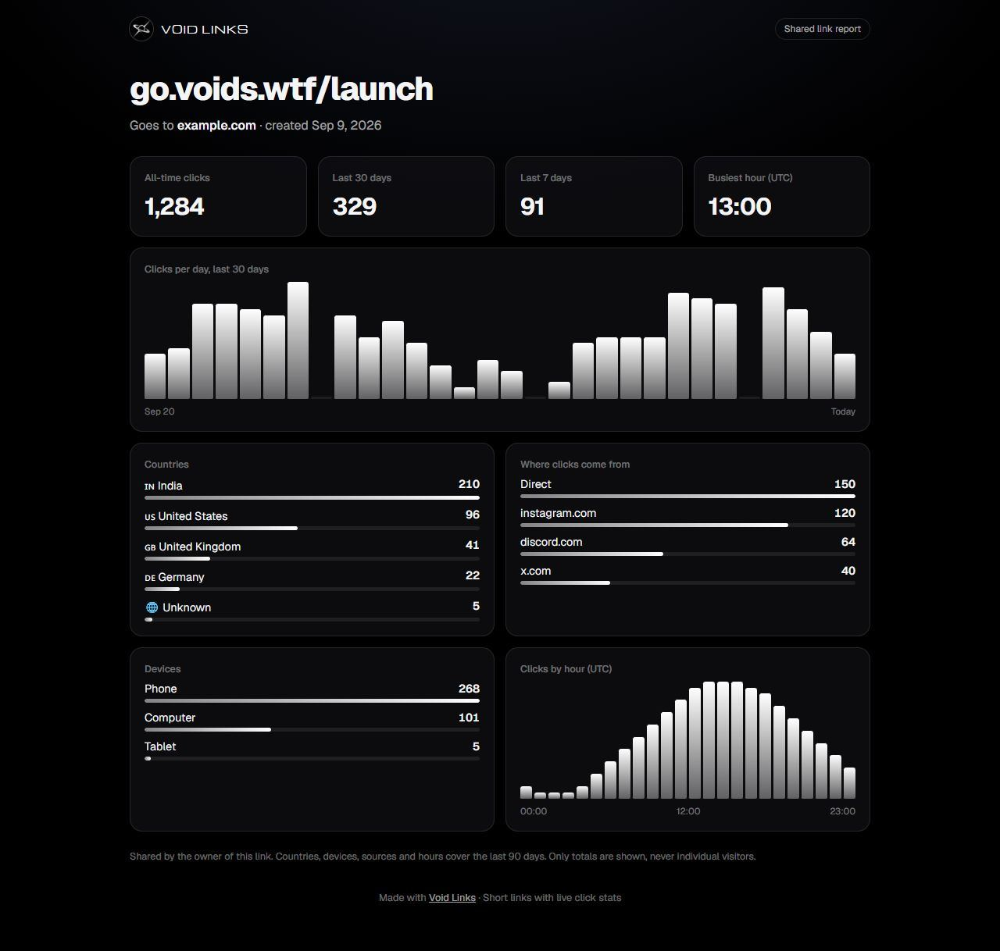
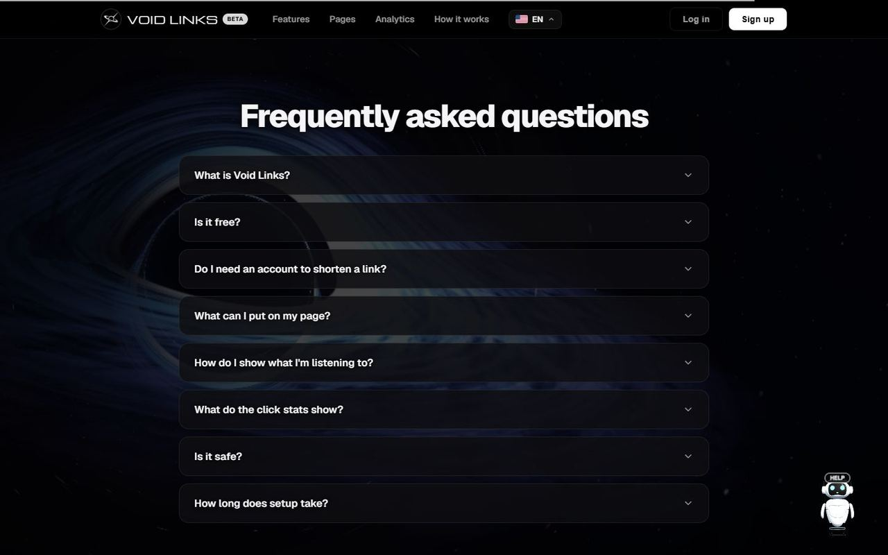
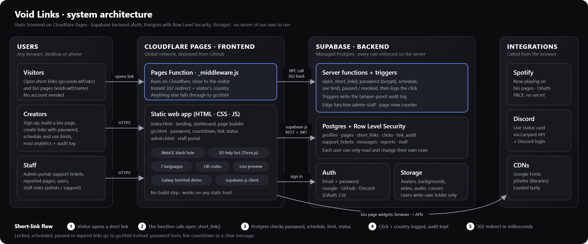

# Void Links

**Shorter links. Longer reach.** Short links you can lock, schedule and track, plus one profile page for everything you share.

Made by **Team Void Century**.

> **This code is shown for viewing and judging only.** It is not licensed for reuse: see [LICENSE](LICENSE).

**Live site:** https://voids.wtf
**Repository:** https://github.com/ryumaz/void-century-void-links
**Short links:** https://go.voids.wtf/&lt;name&gt; · **Profile pages:** https://voids.wtf/&lt;username&gt;



---

## Problem statement

People share links everywhere: bios, Discord servers, posters, client emails. The tools for it are split up and limited:

- Link shorteners give you a short address but little control. You can't easily lock a link with a password, open it on launch day, close it when a sale ends or cap how many times it's used.
- Click stats are often delayed, hidden behind a paywall or missing the basics: where people came from, which country and which device.
- Link-in-bio pages are a separate product with their own account, and most look the same.
- Sharing results with a client or teammate usually means screenshots.

## Our solution

Void Links puts all of this in one free place with one account:

1. **Short links with rules.** Every link can have a password, a start and end time, a use limit and campaign tags. Rules are checked inside the database, so they can't be skipped.
2. **Live click analytics.** Every click is counted the moment it happens, with country, device, source and time of day.
3. **A profile page that feels like yours.** A page at voids.wtf/yourname with a moving background, music, your own icons and cursor, and live Spotify and Discord status.
4. **Reports you can share.** One click turns any link's stats into a read-only page for a client or team. It needs no account and never shows single visitors.

### Why short links *and* a profile page?

Think about how people share themselves today: a bio that says "IG: …, YT: …, Discord: …", or the same five links pasted one by one into every chat, comment and email. It's long, it breaks across apps, and you never know which link anyone actually opened.

Void Links cuts that down to **one link**. Put everything on your profile at `voids.wtf/yourname` and share that instead. When you paste it into WhatsApp, Discord or X, it unfolds into a **profile card** with your name, bio and photo, so people know what they're opening before they tap.

And because it's the same account as your short links, it gets the same treatment: your page has a view counter, your links have click stats, and both live in one dashboard. A short link is for one thing you want to share; your profile page is for **everything** you share.

---

## Features

### Short links
- Shorten any URL with a random or custom name, served at `go.voids.wtf/<name>`
- **Password-protected links:** passwords are hashed with bcrypt in the database, never stored in plain text
- **Scheduled links:** an opening time and an end time
- **Use limits:** a link stops after a set number of uses
- **Pause, resume or revoke** a link at any time
- **UTM builder:** add source, medium, campaign, term and content tags, with a live preview of the final link
- **Edit the destination later:** printed QR codes keep working
- **QR codes:** download or share a QR code for every link and page
- **CSV import:** create up to 200 links at once
- **Audit log:** every change to a link is recorded by database triggers

### Analytics
- Clicks per day over 7, 30 or 90 days
- Countries, devices, referring sites and busiest hours
- Top links and comparison with the previous period
- **Shareable reports:** a public, read-only stats page per link (`voids.wtf/report#…`) that can be turned off any time

### Profile pages
- Your own address: `voids.wtf/yourname`
- Background image, GIF or video (thin black bars in a video are trimmed automatically), with a dim and blur control
- Background music or the video's own sound, with a mute button for visitors
- Link icons for GitHub, Discord, Spotify, Instagram, YouTube and more, or upload your own icon
- Custom cursors: a crosshair or your own image
- **Live Spotify:** what you're playing, with a spinning disc and synced karaoke-style lyrics (LRCLIB)
- **Live Discord status** through Lanyard
- View counter: each visitor counts once a day, and your own visits don't count
- Visitors can report a page to the staff team

### Developer API
- REST API at `/api/v1/links` to list, create, read, update and delete links
- Personal API keys (`vl_…`); only a SHA-256 fingerprint is stored, never the key itself

### Help and safety
- **Vortex**, an on-page helper bot, answers questions and can open a support ticket with a real person
- A staff portal at `/admin` for page reports, support tickets and staff accounts
- Row Level Security on every table, rate limits against spam (200 new links per hour), and a Content Security Policy that only allows our own scripts and a few trusted sources
- Seven languages: English, Spanish, Portuguese, French, German, Turkish and Hindi
- A warning before you leave the page editor with unsaved changes

---

## Screenshots

| | |
|---|---|
|  |  |
| Dashboard and page preview | Profile pages |
|  |  |
| Analytics (sample data) | Creating a link with UTM tags |
|  |  |
| Shared report (sample data) | FAQ |

How the parts fit together:



---

## Tech stack

| Part | What we used |
|---|---|
| Front end | Plain HTML, CSS and JavaScript (no framework, no build step) |
| 3D black hole | WebGL shader (`blackhole.js`) |
| Database, sign-in, file storage | [Supabase](https://supabase.com): PostgreSQL with Row Level Security, Auth (email, GitHub, Google, Discord), Storage, one Edge Function |
| Hosting | Cloudflare Pages |
| Server code | Cloudflare Pages Functions: short-link redirects, profile addresses, the public API |
| Live music and status | Spotify Web API (PKCE sign-in, no secret in the browser), Lanyard for Discord, LRCLIB for lyrics |
| Fonts | Geist, Geist Mono, Michroma (Google Fonts) |

### Project layout

```
index.html            Landing page, dashboard and page editor
pages.js              Profile pages: editor, renderer, Spotify, lyrics
backend.js            All database calls (window.DB)
i18n.js               Translations (7 languages)
helpbot.js/.css       Vortex helper bot and support tickets
blackhole.js          WebGL black hole background
go.html               Password, countdown and "not found" screens for links
report.html           Public shared report page
admin.html/.js        Staff portal
functions/            Cloudflare Pages Functions (redirects, routing, API)
supabase/             Database schema, upgrades, email templates, Edge Function
supabase-config.js    Public settings: Supabase URL, publishable key, Spotify Client ID
```

---

## Setup

Void Links is live at **https://voids.wtf**: nothing to install to try it.

To look at it locally, the site has no build step:

```bash
npx wrangler pages dev . --port 8788
```

Then open http://localhost:8788. (A plain static server such as `python -m http.server` also works for the pages, but short links and the API need the Cloudflare Pages Functions that `wrangler` runs.)

---

## Security

What we did to keep accounts, links and data safe:

- **Row Level Security on every table.** Each person can only read and change their own links, pages and stats. We tested it with the public key: private tables return nothing, and staff-only functions answer "Staff only".
- **No secrets in the code.** The site only ships the Supabase *publishable* key, which can't do anything Row Level Security doesn't allow. The secret key and sign-in provider secrets live only in the Supabase dashboard. We checked every file and the full git history for leaked keys.
- **Link rules are enforced on the server.** Passwords, opening/closing times, use limits, pause and revoke are all checked inside the database when a link opens, so nobody can skip them by editing the page.
- **Link passwords are hashed with bcrypt** and never stored in plain text. Guessing is limited to 8 tries per 10 minutes per visitor, and each wrong guess is slowed down.
- **Rate limits against spam:** 200 new links per hour per account, 600 API calls per key per hour, and limits on support tickets, reports and shared templates.
- **API keys are stored only as SHA-256 fingerprints**, so even we can't see a key after it's created. Keys can be revoked any time.
- **Honest numbers.** Page views count once per visitor per day (using a scrambled fingerprint of the visitor's IP, never the IP itself), and page owners can't edit their own view counts.
- **Audit log.** Every change to a link is recorded by database triggers and can't be edited from the website.
- **Moderation tools.** Visitors can report pages; staff can block single links or whole websites (links to blocked sites can't be created and stop opening) and remove shared backgrounds.
- **A separate staff portal** at `/admin`. It has its own sign-in, kept apart from customer logins on the main site, and is hidden from search engines. Staff have roles (support or admin), and every staff action is checked by the database, not just the page, so a normal account gets nothing even if it opens the portal. Creating staff logins goes through a server function that first confirms the caller is an admin.
- **Safe uploads.** Only images, video and audio, up to 50 MB, and each person can only write to their own folder.
- **Protection against injected scripts (XSS).** Everything people type is shown as plain text, and usernames and link names only allow letters, numbers and a few symbols.
- **Security headers on every page:** a Content Security Policy (only our scripts and a few trusted sources may run, and `eval` is blocked), HTTPS-only with HSTS, no embedding by other sites, `nosniff`, a strict referrer policy and a permissions policy. The one part that needs Spotify's player code runs on its own origin (`go.voids.wtf/radio`) so it can't touch the main site.
- **Privacy:** no tracking cookies and no third-party analytics.

---

## Team

**Void Century**

- Niraj Singh Mehta: team lead, design, full-stack development and deployment
- Udit Saklani: team leader, testing and QA on mobile and desktop
- Naval Panda: pitch
- Urvashi Bhatt: pitch
- Mitali Loshali: pitch

## License

Copyright (c) 2026 Void Century. All rights reserved. The code is public only so it can be viewed and judged; copying, reusing or hosting it needs our written permission. See [LICENSE](LICENSE).
